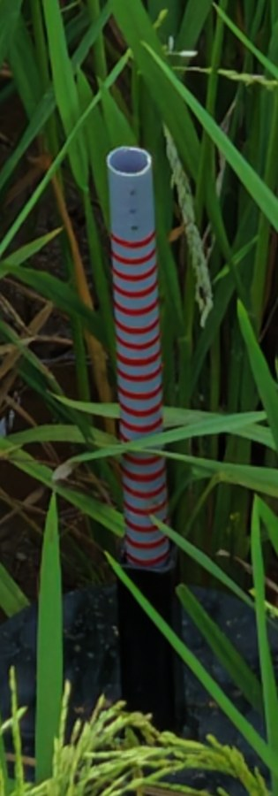
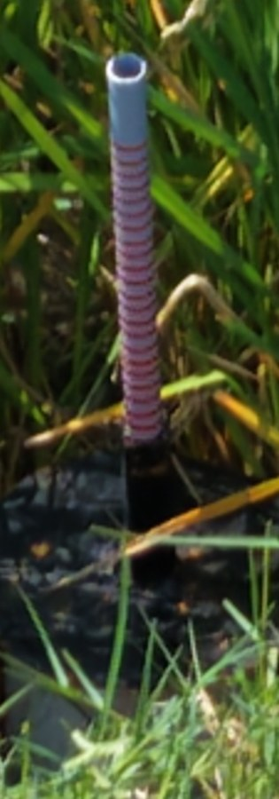
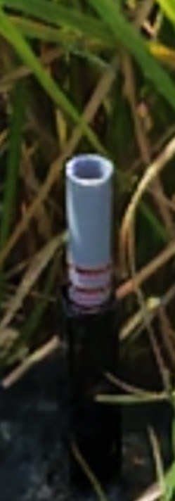

# Pilot capture guide: water-gauge photos

How the photo is taken decides most of the accuracy. On the 127 pilot photos (silver labels, 2026-10-10):

| Photo quality | Photos | Read within 1 ring |
|---|---|---|
| Clear: rod sharp, sleeve visible, rings readable | 103 | **95.1%** (98/103) |
| Blurred, far, or sleeve hidden by leaves | 24 | **54.2%** (13/24) |

That is a **41-point gap**. How large the rod looks matters less than how sharp it is:

- Rods 600 px or longer: 90% within 1 ring.
- Shorter rods: 86% within 1 ring.

## Do this every visit

1. **Two shots, a few seconds apart.** The system fuses them and flags the visit when they disagree.
2. **Side-on, not from above.** Keep the gimbal around -30° to -45°, so the rod stands upright in the frame and its
   rings are separate bands.
3. **Zoom until the rod fills about a quarter of the frame height**, from the plain top cap down to the sleeve.
4. **Hold still until the image is sharp.** A blurred shot loses the rings first.
5. **Clear leaves off the rod if you can** (from the bund, or wait for the wind). Rings hidden at the bottom near the
   sleeve are the hardest case.
6. **Keep the sleeve edge in the picture.** The reading is counted down to it.

## Good and bad examples from this dataset

| Good | Bad: far, rings merge | Bad: blurred |
|---|---|---|
|  |  |  |
| VP plot, 23 Sep, 20 rings: sharp, upright, sleeve visible. Read correctly. | SJ plot, 27 Sep, 24 rings: rings 20 px apart and washed pink. Read as 12. | SJ plot, 1 Oct, 4 rings: motion blur. Read as 0. |

- The far shot goes to the review queue: confidence 0.38, plus a timeline-spike flag.
- The blurred shot does **not**. It read 0 rings at confidence 0.6 and was auto-accepted. This is a known gap: a
  blurred rod with no visible paint is trusted as "all grey, 0 rings". Until confidence also measures sharpness, the
  capture rule above (hold still, two shots) is the guard.
